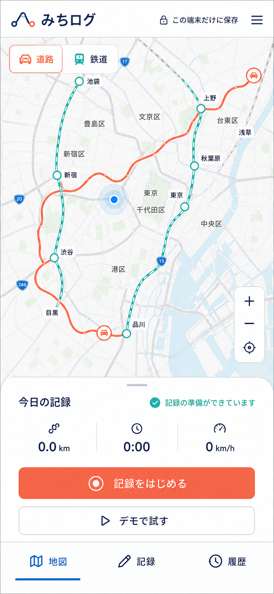

# みちログ

道路や鉄道路線の「通った場所」を、ブラウザの位置情報またはデモ経路から記録するモバイル優先のWebアプリです。



## 初版でできること

- 道路／鉄道モードの切り替え
- ボタン操作後だけ開始するGPS記録
- GPSを許可せず試せるデモ記録
- 距離・時間・速度のリアルタイム表示
- 記録した経路の概略図表示
- 端末内の `localStorage` への保存
- 道路／鉄道別の履歴フィルター
- JSONバックアップの書き出し
- 1件削除／全件削除前の確認
- PCとスマートフォンに対応したレスポンシブ表示

初回表示には、画面と履歴の使い方が分かるサンプル記録が2件入ります。デモ記録を保存した場合も、通常の履歴として端末内に残ります。

## 安全とプライバシー

- 記録開始ボタンを押すまで、位置情報の許可を要求しません。
- サーバー、分析サービス、外部地図APIへの送信はありません。
- 外部APIキーや秘密情報は必要ありません。
- 保存キーにはスキーマバージョンを付け、読み込み時にデータを検証します。
- 保存領域が無効・容量不足の場合は、画面上で警告します。
- 削除は確認ダイアログを通し、バックアップをJSONで取得できます。
- Content Security Policyで、読み込めるスクリプトや通信先を同一オリジンに制限しています。

位置情報APIは、通常 `localhost` またはHTTPS配信でのみ利用できます。記録データには行動履歴が含まれるため、共有PCではブラウザプロファイルの扱いに注意してください。

## 開発

Node.jsとnpmが必要です。

```bash
npm install
npm run dev
```

ブラウザで <http://127.0.0.1:5173/> を開きます。

```bash
npm test
npm run build
npm audit --omit=dev
```

## 構成

- `src/hooks/useJourneyRecorder.ts`: GPS・デモ記録の状態とライフサイクル
- `src/lib/geo.ts`: 距離、速度、表示形式の純粋関数
- `src/lib/storage.ts`: バージョン付き端末保存と入力検証
- `src/components/MapCanvas.tsx`: 外部通信をしない概略地図
- `src/components/RecordingPanel.tsx`: 記録操作と現在値
- `src/components/HistoryView.tsx`: 履歴、フィルター、バックアップ、削除
- `docs/design/`: 実装時に基準としたPC／スマホ画面コンセプト
- `docs/product-brief.md`: 質問、初版の仮定、将来の判断事項

## 現在の制約

- 背景地図は東京をイメージした概略図で、実際の道路・線路には自動補正しません。
- GPXの取込／書出し、写真添付、アカウント同期、共有、オフライン起動は未実装です。
- 位置精度は端末・ブラウザ・周囲の環境に依存します。
- GPSの自動テストには実端末の許可操作が必要です。ブラウザQAでは、外部へ位置を送らないデモ記録を使っています。

要件を具体化する質問と、回答に応じた拡張候補は [プロダクト概要](docs/product-brief.md) にまとめています。

