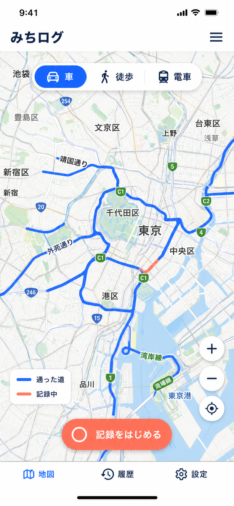

# みちログ

車・徒歩・電車で通った区間を一枚の地図へ青く塗り重ねていく、モバイル優先の個人用Webアプリです。

## 公開版

- アプリ: <https://michilog.vercel.app/>
- ソースコード: <https://github.com/Azama-K/michilog>
- ホスティング: Vercel Hobby（個人・非商用利用）



## できること

- 保存済みの全経路を、1枚の地図へ「通った道」として青く累積表示
- 車／徒歩／電車モードの切り替え
- ボタン操作後だけ開始するGPS記録
- GPSを許可せず試せるデモ記録
- 記録中の経路を赤く表示し、終了すると青い通過済み経路へ追加
- 誤差の大きいGPS点・停車中のふらつき・ありえない速度の飛び値を除き、保存時は線の形を保ったまま点を間引く
- 記録中は画面の自動消灯を止める（Screen Wake Lock API。非対応のブラウザでは画面を点けたままにするよう案内）
- OpenStreetMap上での拡大・縮小・全経路表示
- 端末内の `localStorage` への保存
- 車／徒歩／電車別の履歴フィルター
- JSONバックアップの書き出しと読み込み（既存の記録は残し、まだない記録だけを追加）
- 1件削除／全件削除前の確認
- PCとスマートフォンに対応したレスポンシブ表示

記録がまだないときは、首都高C1一周、外苑通りの一部、靖国通りの徒歩区間、山手線の一部をイメージしたサンプル経路を灰色の点線で表示します。サンプルは自分の記録とは別扱いで、履歴・累計距離・バックアップには含まれません。最初のGPS記録を保存すると自動で非表示になり、設定から表示を切り替えられます。デモ記録を保存した場合は、履歴に「デモ」と表示して端末内に残ります。

この版の中心は「1回ごとの旅を振り返ること」ではなく、「通過済みの区間を地図上で少しずつ増やすこと」です。履歴は補助画面として残しています。

## 安全とプライバシー

- 記録開始ボタンを押すまで、位置情報の許可を要求しません。
- GPSの記録データはアプリのサーバーや分析サービスへ送らず、端末内だけに保存します。
- 背景地図の表示時は、現在の表示範囲に対応する地図画像をOpenStreetMapから取得します。
- Google Maps APIキーなどの秘密情報は必要ありません。
- 保存キーにはスキーマバージョンを付け、読み込み時にデータを検証します。
- 保存領域が無効・容量不足の場合は、画面上で警告します。
- 削除は確認ダイアログを通し、バックアップをJSONで取得できます。
- Content Security Policyで、スクリプトは同一オリジン、地図画像はOpenStreetMap公式タイルだけに制限しています。

位置情報APIは、通常 `localhost` またはHTTPS配信でのみ利用できます。記録データには行動履歴が含まれるため、共有PCではブラウザプロファイルの扱いに注意してください。

## 開発

Node.jsとnpmが必要です。

公開環境と同じNode.js 22を使用します。

```bash
npm install
npm run dev
```

ブラウザで <http://127.0.0.1:5173/> を開きます。

```bash
npm test
npm run build
npm audit --omit=dev
```

## 構成

- `src/hooks/useJourneyRecorder.ts`: GPS・デモ記録の状態とライフサイクル
- `src/lib/geo.ts`: 距離、速度、表示形式の純粋関数
- `src/lib/trackFilter.ts`: GPS点の採用判定（交通手段ごとの基準）と保存時の間引き
- `src/hooks/useWakeLock.ts`: 記録中の画面消灯防止
- `src/lib/storage.ts`: バージョン付き端末保存、設定、バックアップの読み込みと入力検証
- `src/components/MapCanvas.tsx`: Leafletによる実地図、経路、現在位置の表示
- `src/components/RecordingPanel.tsx`: 地図上の記録開始／終了操作
- `src/components/HistoryView.tsx`: 履歴、フィルター、バックアップ、削除
- `docs/design/`: 実装時に基準としたPC／スマホ画面コンセプト
- `docs/product-brief.md`: 質問、初版の仮定、将来の判断事項

## 現在の制約

- 背景地図の表示にはインターネット接続が必要で、OpenStreetMapの提供状況に依存します。
- GPS点はノイズを除くだけで、道路・線路へは自動補正しません。現在の青線は端末が取得したGPS点を結んだ軌跡で、C1など道路名単位の走破率や「全区間通過済み」の厳密な判定はまだ行いません。
- GPXの取込／書出し、写真添付、アカウント同期、共有、オフライン起動は未実装です。
- 位置精度は端末・ブラウザ・周囲の環境に依存します。
- iPhoneのSafariでは、画面が消えたりほかのアプリに切り替えたりするとWebページの位置取得が止まります。消灯は防いでいますが、手動でロックした間の区間は記録されません。
- GPSの自動テストには実端末の許可操作が必要です。ブラウザQAでは、端末の現在位置を取得しないデモ記録を使っています。

要件を具体化する質問と、回答に応じた拡張候補は [プロダクト概要](docs/product-brief.md) にまとめています。
